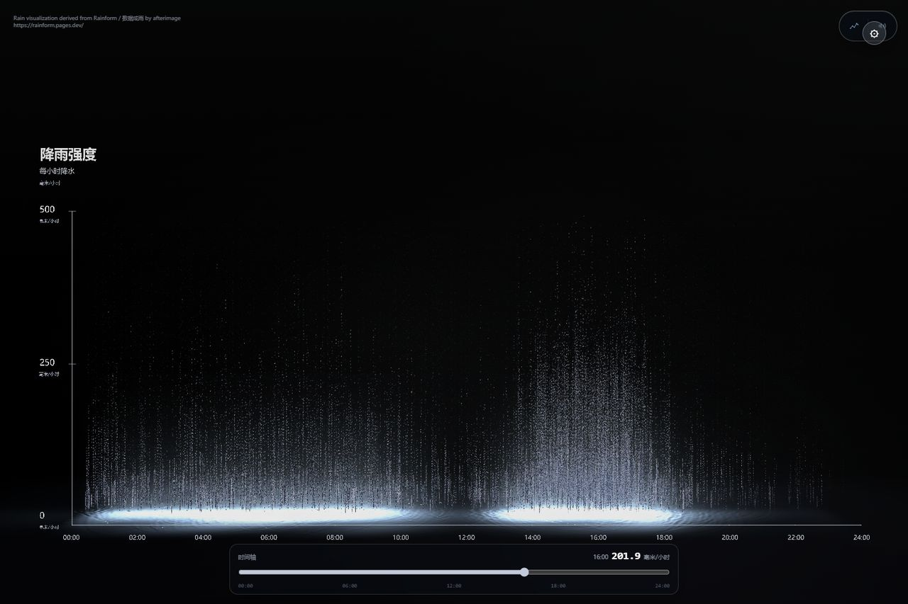

# 雨境 RainScope · 暴雨数据可视化

[](LICENSE)
[](https://storm-rainfall-visualization.shiqiyu-ai.chatgpt.site)
[](https://github.com/1-1-1-11/RainScope/actions/workflows/ci.yml)



雨境 RainScope 是基于 [Rainform / 数据成雨](https://rainform.pages.dev/)（© 2026 afterimage，PolyForm Noncommercial 1.0.0）的非商业增强 fork，由 shiqiyu 维护。它把 00:00–24:00 的 25 个逐时降雨数据点转化为实时 Three.js/WebGL 粒子雨景，并增加事实锚定的暴雨重建数据集、数据集切换、时间轴读数与水花层。

RainScope is a noncommercial enhancement fork of [Rainform / 数据成雨](https://rainform.pages.dev/) (© 2026 afterimage, PolyForm Noncommercial 1.0.0), maintained by shiqiyu. It turns 25 hourly rainfall values from 00:00–24:00 into an interactive Three.js/WebGL landscape, with fact-anchored storm reconstructions, dataset switching, a timeline readout and splash impacts.

## 与原作的差异 / What this fork adds

- **真实暴雨数据集 / Real storm datasets**：郑州 7·20（重建）16:00 峰值 201.9 mm/h、重建日合计 624.1 mm；北京 23·7（重建）保留 744.8 mm 过程累计元数据，小时锚点 111.8 mm/h（10:00）。Reconstructed Zhengzhou 7·20 (201.9 mm/h at 16:00, 624.1 mm daily) and Beijing 23·7 (744.8 mm process total, 111.8 mm/h hourly anchor) datasets.
- **水花溅落层 / Splash impact layer**：郑州 16:00/201.9 现场实测 foam 2117、spray 1233、crowns 427 个粒子。Measured 2117 foam, 1233 spray and 427 crown particles at the Zhengzhou 16:00 peak.
- **0–24 时间轴 / 0–24 timeline**：25 点逐时曲线配原生滑块与实时读数，拖到 16:00 即显示 201.9 mm/h。A native 0–24 h slider with live readout over the 25-point hourly curve.
- **生产可用的 128 参数效果控制台 / Production 128-parameter effect console**：实时调节粒子、水花与画质，9 个性能输入带安全钳制上限，改动持久化。Live tuning of 128 parameters with safe clamps on 9 performance inputs and local persistence.

  

- **冻结 smoke + CI / Frozen smoke + CI**：smoke 以哈希锁定 `LICENSE`、`NOTICE.md` 与判卷脚本，CI 连续跑 `npm run check`、smoke 与 Node 测试三道验收。Hash-frozen smoke protects license and grading files; CI runs check, smoke and Node tests on every push.

> **源码许可 / Source terms:** 源码仅授权非商业学习、修改与分发；禁止商业使用、商业产品集成、广告和品牌项目。Source is available for noncommercial use only and is not OSI-approved open-source software. See [LICENSE](LICENSE) and [COMMERCIAL_USE.md](COMMERCIAL_USE.md).

## 功能 / Highlights

- 原作演示、郑州 7·20 与北京 23·7 三套 25 点曲线 / Three 25-point curves: original demo, Zhengzhou 7·20 and Beijing 23·7
- 25 个逐时降雨数据点与实时可拖拽曲线 / 25 hourly rainfall values with a live draggable curve
- 数据驱动的粒子雨幕、峰值瀑布、水面波纹、坐标轴与雨声 / Data-driven rain, waterfall, water, axes and sound
- 桌面端视角拖拽、双击重置、声音切换与精确数据输入 / Desktop camera, reset, sound and precise editing
- 移动端横屏适配、安全区域与方向切换恢复 / Mobile landscape, safe-area and orientation recovery
- 中英文界面 / Chinese and English interface

## 本地开发 / Development

Requirements: Node.js 20 or newer.

```bash
npm.cmd ci
npm.cmd run dev
```

## 构建 / Build

```bash
npm.cmd run check
npm.cmd run preview
```

`npm run check` validates the Chinese/English interface and production build. Contributor validation requirements are documented in [CONTRIBUTING.md](CONTRIBUTING.md).

## 项目结构 / Structure

```text
.
├── index.html              # Application shell, metadata and controls
├── src/
│   ├── bootstrap.js        # Locale, mobile gate and deferred startup
│   ├── rainfall-datasets.js # Sourced demo and reconstructed rainfall datasets
│   ├── main.js             # Three.js scene, data model and interactions
│   └── styles.css          # Responsive application styles
├── public/                 # Runtime assets and Cloudflare headers
├── scripts/                # Validation and maintainer media tools
├── docs/                   # Architecture, licensing and integration policy
└── .github/                # CI, dependency updates and contribution templates
```

## 来源与归属 / Attribution

Rain visualization derived from Rainform / 数据成雨 by afterimage  
https://rainform.pages.dev/

本增强版仅作非商业学习、修改与分发，保留原作 `LICENSE`、`NOTICE.md` 与所有 Required Notice。

## 使用与许可 / Usage and license

Noncommercial study, modification and redistribution are permitted under the [PolyForm Noncommercial License 1.0.0](LICENSE). Every copy or derived work must retain:

```text
Required Notice: Rainform / 数据成雨 © 2026 afterimage — https://rainform.pages.dev/
```

Attribution alone does not make commercial use permissible. Work from this source repository, preserve the license and notice, and read the [integration policy](docs/INTEGRATION.md) before combining Rainform with another project.

The source license does not grant rights to use the Rainform / 数据成雨 name, logo or visual identity as another product's branding. See [TRADEMARKS.md](TRADEMARKS.md).

Copyright © 2026 afterimage.

## 项目文档 / Project documentation

- Architecture: [docs/ARCHITECTURE.md](docs/ARCHITECTURE.md)
- Contribution guide: [CONTRIBUTING.md](CONTRIBUTING.md)
- Security reports: [SECURITY.md](SECURITY.md)
- Release history: [CHANGELOG.md](CHANGELOG.md)
- Third-party notices: [THIRD_PARTY_NOTICES.md](THIRD_PARTY_NOTICES.md)
